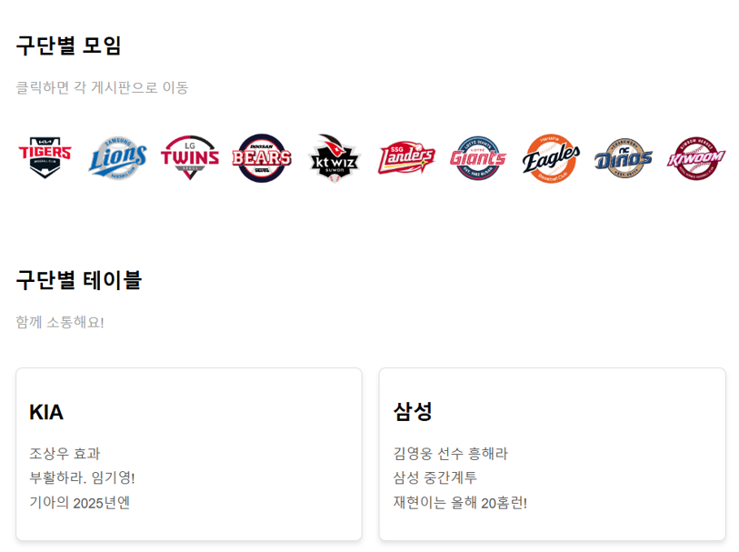
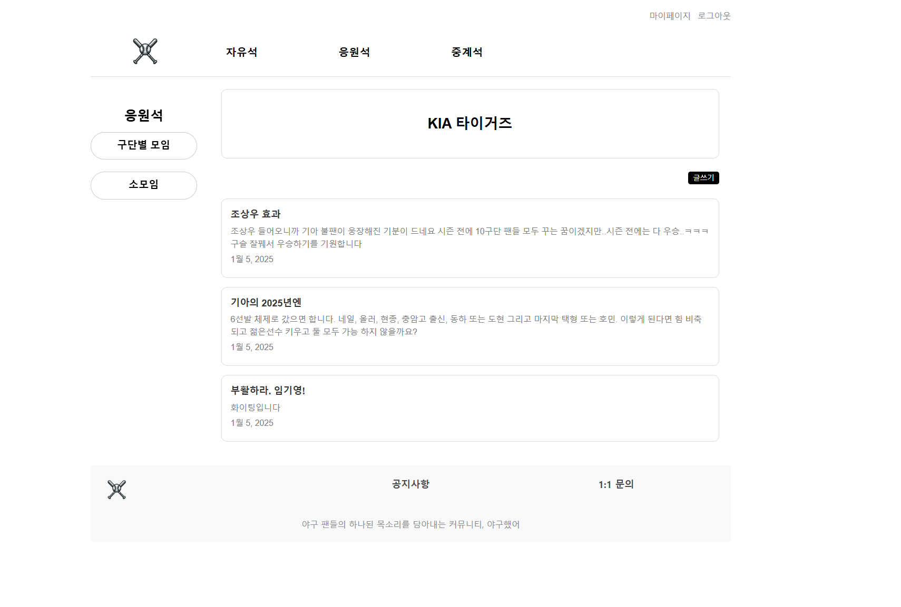
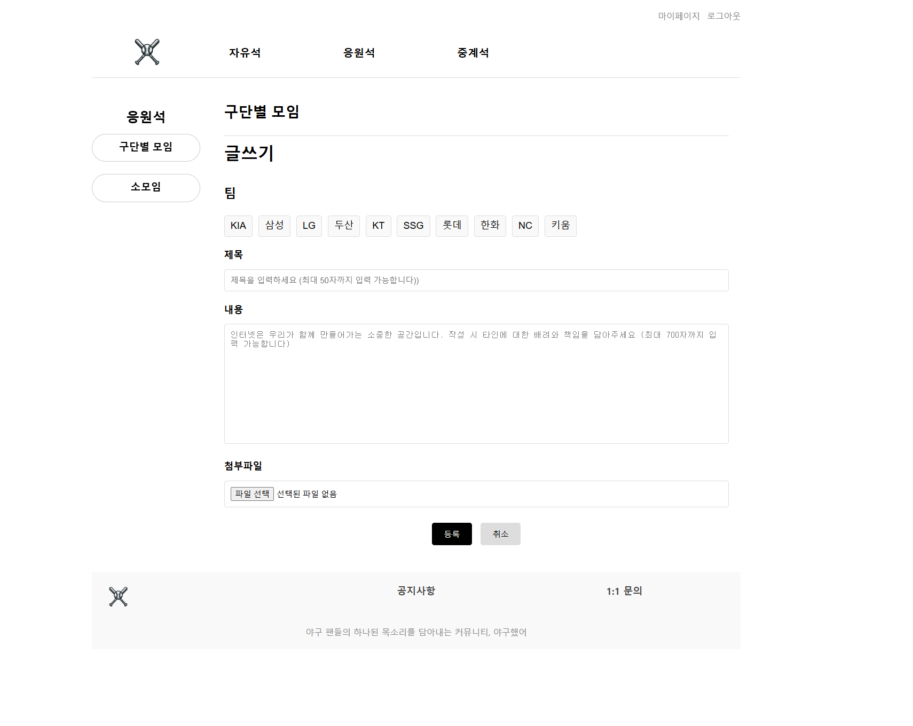
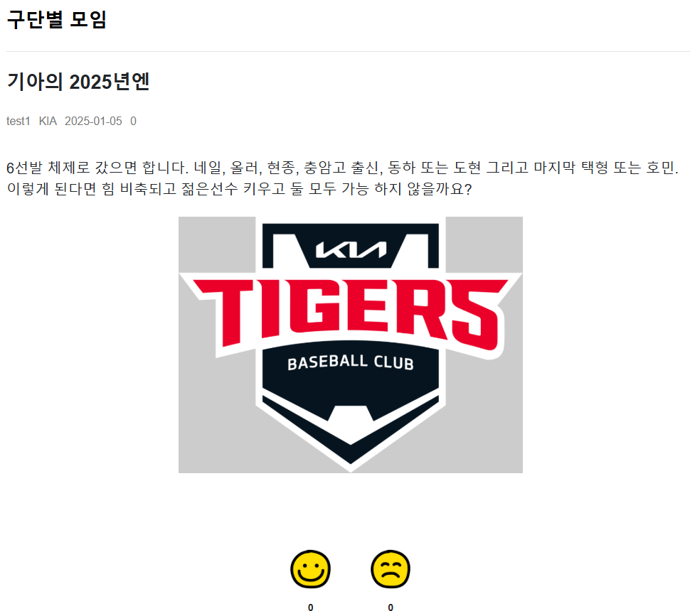
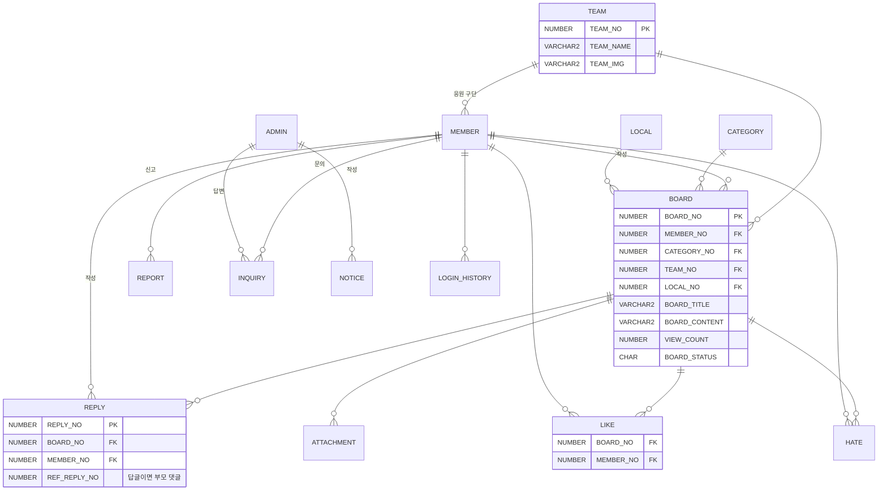

# ⚾ 야구했어 — KBO 팬 커뮤니티

> 야구 팬들의 하나된 목소리를 담아내는 커뮤니티.
> 구단별 게시판, 소모임, 직관 후기, 야구 뉴스를 한곳에서 볼 수 있는 웹 서비스입니다.

| 항목 | 내용 |
|---|---|
| 기간 | 2024.12 ~ 2025.01.06 (학원 세미 프로젝트) |
| 인원 | 팀 프로젝트 5명 |
| 내 역할 | **구단별 모임 게시판** 기획·화면 설계·프론트·백엔드 전체 |
| 형태 | 프레임워크 없이 Servlet/JSP로 MVC 패턴을 직접 구성 |

 

## 🛠 기술 스택

| 구분 | 사용 기술 |
|---|---|
| Backend | Java 17, Servlet/JSP (MVC2), JDBC + Apache DBCP2 커넥션 풀 |
| Database | Oracle 21c XE |
| Frontend | JSP, HTML/CSS, JavaScript, jQuery(Ajax), Bootstrap |
| 기타 | cos.jar(파일 업로드), Gson, Selenium·jsoup(뉴스 크롤링), ScheduledExecutorService |
| Server / Tool | Apache Tomcat 9, Eclipse, SQL Developer, Git/GitHub |

 

## 📌 전체 기능

- **회원**: 회원가입, 로그인/로그아웃, 마이페이지, 프로필 이미지 변경, 아이디·비밀번호 찾기
- **응원석**: 구단별 모임 게시판, 소모임 게시판
- **게시판**: 굿즈 게시판, 직관 후기 게시판
- **야구 뉴스**: 네이버 스포츠 KBO 뉴스를 15분마다 자동 크롤링 (`@WebListener` + `ScheduledExecutorService`)
- **공통**: 댓글/답글, 좋아요·싫어요, 게시글·댓글 신고, 첨부파일
- **고객센터**: 공지사항, 1:1 문의
- **관리자**: 회원 관리, 문의 답변, 신고 처리

 

## 🙋‍♂️ 내가 구현한 기능 — 구단별 모임 게시판

### 1. 구단별 모임 메인
- 10개 구단 로고를 클릭하면 해당 구단 게시판으로 이동
- 구단마다 `teamNo`를 부여하고, 로고 이미지 파일명을 `teamNo`와 맞춰 매핑
- "구단별 테이블"에 구단별 최신 글 제목을 보여주고, 클릭하면 상세 페이지로 이동

### 2. 구단별 게시판 (`/board/gudan/*`)
- URL의 `teamNo`에 맞는 배너와 게시글 목록을 렌더링

### 3. 글쓰기 / 수정 / 삭제
- 구단 선택, 제목, 내용을 **필수 입력**으로 검증 (누락 시 등록되지 않음)
- `MultipartRequest`(cos.jar)와 직접 만든 `FileRenamePolicy`로 첨부파일 업로드 (최대 10MB, 저장 파일명 변경)
- 수정할 때 첨부파일 옆의 X를 누르면 기존 파일 삭제
- 삭제 확인 알림 후 구단별 모임 메인으로 이동

### 4. 게시글 상세
- **좋아요 / 싫어요**: 한 회원은 게시글마다 한 번만 누를 수 있고, 다시 누르면 취소됩니다. Ajax로 개수만 갱신합니다.
- **댓글 / 답글** 작성·수정·삭제 (답글은 `REF_REPLY_NO`로 부모 댓글 참조)

 

## 💡 구현 포인트

**좋아요·싫어요 중복 방지**
- `LIKE`, `HATE` 테이블에 (게시글 번호, 회원 번호)를 기록합니다.
- 버튼을 누르면 `checkLike`로 이 회원이 이미 눌렀는지 먼저 확인합니다. 누른 적이 있으면 삭제하고, 없으면 추가하는 **토글** 방식입니다.
- 처리 후에는 `countLike`로 최신 개수를 응답해서 페이지 새로고침 없이 반영합니다.

**구단 정보와 화면 매핑**
- 구단 이름·로고·게시판을 `teamNo` 하나로 연결했습니다. 덕분에 목록·배너·글쓰기 화면이 같은 기준으로 동작합니다.

**계층 분리**
- Controller(Servlet) → Service → DAO 계층을 나눴습니다.
- SQL은 XML(`sql/board/board-mapper.xml`)로 분리하고, 트랜잭션(commit/rollback)은 Service에서 직접 관리했습니다.

 

## 🗂 ERD

전체 스크립트: [`docs/schema.sql`](docs/schema.sql)

 

## ▶ 실행 방법

1. Oracle XE에서 `docs/schema.sql`을 실행합니다.
2. DB 계정을 환경변수 `SEMI_DB_USER`, `SEMI_DB_PASSWORD`로 지정합니다. 지정하지 않으면 `C##SEMI` / `change-me`를 씁니다.
3. Eclipse에서 *Existing Projects into Workspace*로 가져온 뒤 Tomcat 9에 올려 실행합니다.
4. (선택) 뉴스 크롤링을 쓰려면 Chrome 버전에 맞는 chromedriver를 `driver/chromedriver`에 두거나 `-Dwebdriver.chrome.driver=경로`로 지정합니다.

> 구단 로고, 크롤링한 뉴스 이미지, 사용자 업로드 파일은 저작권과 개인정보 문제로 저장소에서 제외했습니다.

 

## 📝 회고

- 프레임워크 없이 요청 처리, 커넥션 풀, 트랜잭션, 파일 업로드를 직접 다루면서 Spring이 대신 해 주는 일이 무엇인지 체감했습니다.
- 화면 시안(HTML)부터 DB 설계, 구현까지 한 기능을 끝까지 맡아 완성한 경험이었습니다.
- 아쉬운 점
  - 좋아요 중복 방지를 애플리케이션 로직(`checkLike`)에만 의존합니다. 다시 만든다면 `LIKE` 테이블에 (게시글, 회원) 복합 기본키를 걸어 DB에서도 막겠습니다.
  - 회원 비밀번호를 평문으로 저장합니다. 다시 만든다면 BCrypt로 해시해서 저장하겠습니다.
